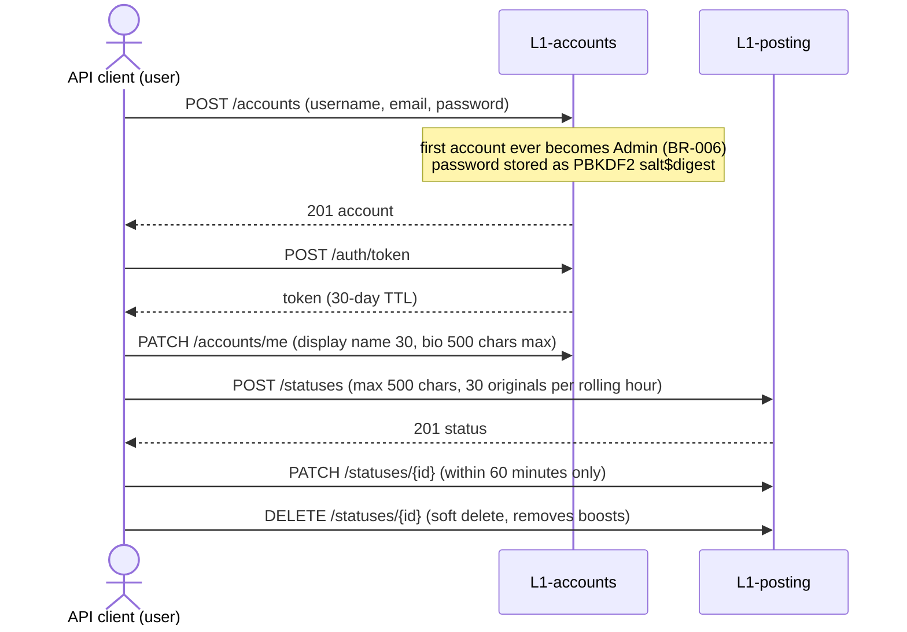
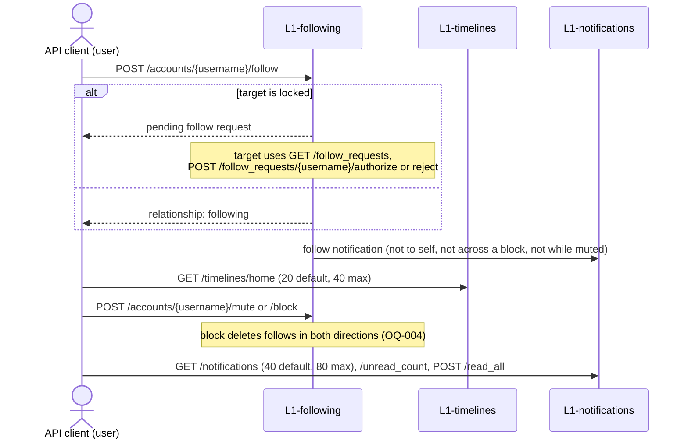
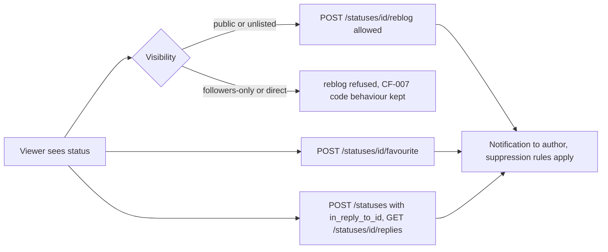
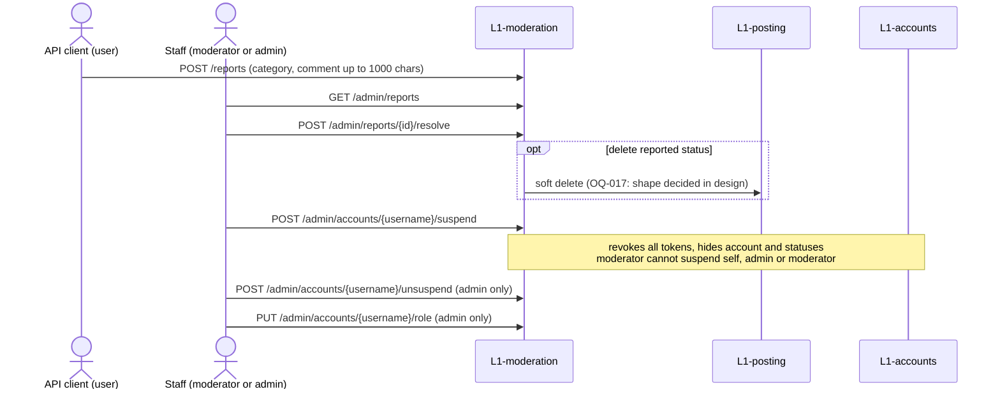
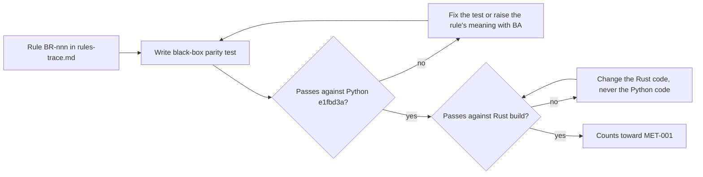

# Journeys: REBUILD-MINIDON

Drafted by research-agent on 2026-11-12. minidon is a backend API with no screens (GAP-007
waived), so these are API-client journeys over the 40 endpoints of the Python reference at
`e1fbd3a`. The journeys are DERIVED from the route files and the baseline capabilities. They do
not change in the rebuild: each one must behave the same on the Rust build, and each step is a
candidate for the differential run in NFR-003. Paths are shown without the `/api/v1` prefix the
routers mount under.

## J1. Join, sign in and post (L1-accounts, L1-posting)

## J2. Follow and read the home timeline (L1-following, L1-timelines, L1-notifications)

## J3. Interact with a status (L1-posting, L1-notifications)

## J4. Report and moderate (L1-moderation, L1-posting, L1-accounts)

## J5. Prove parity for one rule (delivery journey, new in this run)

