# Value stream: REBUILD-MINIDON, ticket to proven parity

> **Lane note.** This file belongs to the RESEARCH_FLOWS branch, owned by **ux-context-agent**.
> It was drafted by **research-agent**, not by ux-context-agent, and revised by research-agent
> on 2026-11-12 after research review 001. ux-context-agent has not reviewed it, and the
> RESEARCH_FLOWS branch is still open. A lane review should check that the step times match
> the run ledger, that the waits ahead are marked unknown rather than guessed, and that the
> build waves match the dependency order design settles on.

Times already spent are STATED from the run ledger (`.mw/runs/REBUILD-MINIDON/ledger.jsonl`).
Times ahead are DERIVED from `estimate.json` (DEMO content, agentic range) or marked unknown.
There is no delivery history to calibrate against (GAP-006 waived), so wait times ahead are
unknown.

```mermaid
flowchart LR
  B[Baseline<br/>BASELINE-2026-10-30<br/>confirmed 2026-11-10] --> P[Pull and context<br/>~4.8 h elapsed]
  P --> RI[Research intake<br/>~4 min]
  RI --> RD[Research draft<br/>done]
  RD --> RR[Research review 001<br/>and revision]
  RR --> G1{{Research gate<br/>wait: unknown}}
  G1 --> PL[Plan and spec<br/>2-4 d, wait unknown]
  PL --> G2{{PRD and plan gates<br/>wait: unknown}}
  G2 --> W1[Wave 1: platform, harness, Accounts]
  W1 --> W2[Wave 2: Following]
  W2 --> W3[Wave 3: Posting, Timelines, Notifications, Moderation]
  W3 --> V[Parity and compatibility proven<br/>MET-001 = 80 of 80, MET-004 = 0]
  V --> X[Cutover: separate ticket]
```

| Step | Process time | Wait time | Source |
|---|---|---|---|
| Baseline (Activity 01) | not in this run; human gate approval 2026-11-10 | - | `.mw/runs/BASELINE-2026-10-30/ledger.jsonl` seq 8 |
| Pulled to context ready | about 4 h 46 min elapsed (2026-11-11 23:15 to 2026-11-12 04:02 UTC), mostly gap closing and waivers | included in elapsed | STATED, ledger |
| Context ready to research intake to research draft | about 9 min elapsed (04:02 to 04:11 UTC) | included | STATED, ledger |
| Research draft, review 001 and revision | under 1 d | unknown: one reviewer holds every lane (RISK-007); lane branches still open | DERIVED |
| Plan, PRD and spec | 2 to 4 d human effort | unknown | DERIVED from estimate.json |
| Build waves 1 to 3 (6 capabilities plus platform and harness) | most of the agentic range: 14 to 28 d of stories, plus 2 to 5 d for framework behaviour (RISK-003) | unknown: PR review wait per wave | DERIVED from estimate.json (agentic 16 to 34 d total, DEMO) |
| Acceptance (parity and compatibility suites green) | 1 d | unknown | DERIVED |
| Measure | each CI run; outcome judged by 2027-03-31 | n/a | outcome.json falsifiedIf |

## Where time is likely to be lost

- Gate waits: with one person in every role, every gate queues on the same person. DERIVED.
- Parity failures that need a judgement on what a rule means (go back to the BA lane). DERIVED.
- Data-compatibility and text-semantics surprises found late (RISK-002, RISK-010). Building the
  compatibility suite and the Unicode input class in wave 1 moves that discovery to the start.
  DERIVED.
- Unknown: how long the Rust platform decision (DEP-003) takes.
