# Value stream: REBUILD-MINIDON, ticket to proven parity

Drafted by research-agent on 2026-11-12. Times already spent are STATED from the run ledger
(`.mw/runs/REBUILD-MINIDON/ledger.jsonl`). Times ahead are DERIVED from `estimate.json`
(DEMO content, agentic range) or marked unknown. There is no delivery history to calibrate
against (GAP-006 waived), so wait times ahead are unknown.

```mermaid
flowchart LR
  B[Baseline<br/>BASELINE-2026-10-30<br/>done] --> P[Pull and context<br/>~4.8 h elapsed]
  P --> RI[Research intake<br/>~4 min]
  RI --> RD[Research draft<br/>in progress]
  RD --> G1{{Research gate<br/>wait: unknown}}
  G1 --> PL[Plan and spec<br/>2-4 d, wait unknown]
  PL --> G2{{PRD and plan gates<br/>wait: unknown}}
  G2 --> W1[Wave 1: platform, harness, Accounts]
  W1 --> W2[Wave 2: Following]
  W2 --> W3[Wave 3: Posting, Timelines, Notifications, Moderation]
  W3 --> V[Parity and compatibility proven<br/>MET-001 = 82, MET-004 = 0]
  V --> X[Cutover: separate ticket]
```

| Step | Process time | Wait time | Source |
|---|---|---|---|
| Baseline (Activity 01) | not in this run | - | `.mw/context/baseline.json`, BASELINE-2026-10-30 |
| Pulled to context ready | about 4 h 46 min elapsed (2026-11-11 23:15 to 2026-11-12 04:02 UTC), mostly gap closing and waivers | included in elapsed | STATED, ledger |
| Context ready to research intake to research draft | about 9 min elapsed (04:02 to 04:11 UTC) | included | STATED, ledger |
| Research draft and review | under 1 d | unknown: one reviewer holds every lane (RISK-007) | DERIVED |
| Plan, PRD and spec | 2 to 4 d human effort | unknown | DERIVED from estimate.json |
| Build waves 1 to 3 (6 capabilities plus platform and harness) | 9 to 20 d human effort across waves | unknown: PR review wait per wave | DERIVED from estimate.json (agentic 12 to 25 d total) |
| Acceptance (parity and compatibility suites green) | 1 d | unknown | DERIVED |
| Measure | each CI run; outcome judged by 2027-03-31 | n/a | outcome.json falsifiedIf |

## Where time is likely to be lost

- Gate waits: with one person in every role, every gate queues on the same person. DERIVED.
- Parity failures that need a judgement on what a rule means (go back to the BA lane). DERIVED.
- Data-compatibility surprises found late (RISK-002). Building the compatibility suite in wave 1
  moves that discovery to the start. DERIVED.
- Unknown: how long the Rust platform decision (DEP-003) takes.
